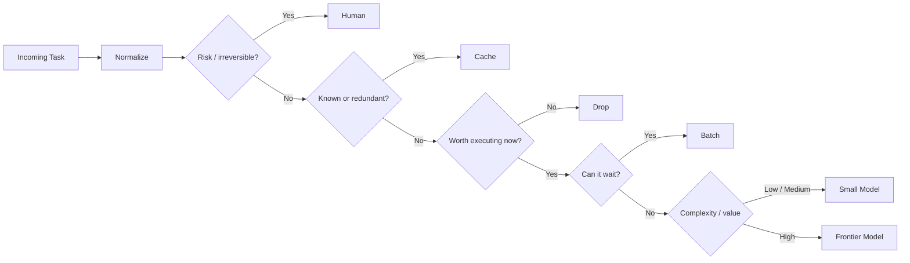

<div align="center">

# Optimized Task Controller

### A decision layer that decides what deserves inference.

**Route less. Batch more. Escalate what matters.**

`CACHE` · `SMALL MODEL` · `FRONTIER MODEL` · `BATCH` · `DROP` · `HUMAN`

<br>


</div>

---

## What is OTC?

**Optimized Task Controller** is a lightweight control layer that sits **in front of the queue**.

Instead of sending every task directly to the biggest model, OTC first decides whether the task should:

- reuse a known answer,
- go to a small model,
- go to a frontier model,
- wait for a batch,
- be dropped,
- or require a human.

The core idea is simple:

> **A model should not answer a question that a controller can eliminate, reuse, delay, or route more efficiently.**

---

## Why this exists

Modern agent systems generate huge amounts of work:

- background agents,
- user requests,
- cron jobs,
- webhooks,
- monitoring events,
- internal tools,
- human operators.

Most of those tasks **do not need the same model**.

OTC separates **task generation** from **model execution**.

It turns this:

```text
task → frontier model
task → frontier model
task → frontier model
task → frontier model
```

into this:

```text
task
  ↓
controller
  ├── cache
  ├── small model
  ├── frontier model
  ├── batch
  ├── drop
  └── human
```

---

## Decision pipeline



Each decision produces a **routing receipt** with:

```text
decision
score
reason
model tier
```

---

## Six possible decisions

| Decision | What it means |
|---|---|
| `CACHE` | Reuse an existing answer or known state |
| `SMALL_MODEL` | Route to the cheapest capable model tier |
| `FRONTIER_MODEL` | Reserve frontier inference for high-value / high-complexity work |
| `BATCH` | Delay non-urgent work and process it together |
| `DROP` | Skip redundant or low-value work |
| `HUMAN` | Escalate risky or irreversible actions |

---

## Example workload

The repository ships with a deterministic demo workload.

```text
8,400 tasks

54.8%  → small model
18.2%  → batch
11.4%  → cache
 8.6%  → frontier model
 5.4%  → drop
 1.6%  → human
```

> These percentages are **example workload settings for the included simulator**, not universal production benchmarks.

The point of the demo is to show how a controller can distribute work across multiple outcomes instead of treating every task the same.

---

## Scoring model

OTC uses a small set of explicit signals:

```text
worth
novelty
urgency
complexity
redundancy
risk
reversibility
```

A simplified value score:

```text
value =
    worth
  + novelty
  + urgency
  + complexity
  - redundancy
```

Risk and irreversibility are handled as **gates**, not just weighted features.

All thresholds are configurable in:

```text
config/controller.json
```

---

## Quick start

### Requirements

- Python 3.10+

### Run the demo

```bash
python -m src.optimized_task_controller.cli --simulate 8400
```

### Try a single task

```bash
python -m src.optimized_task_controller.cli \
  --task "Summarize the latest deployment logs" \
  --worth 0.7 \
  --novelty 0.4 \
  --urgency 0.7 \
  --complexity 0.3
```

Example output:

```text
decision: SMALL_MODEL
score: 0.445
reason: small model is the cheapest capable tier
model_tier: small
```

---

## Python usage

```python
from src.optimized_task_controller import (
    OptimizedTaskController,
    Task,
)

controller = OptimizedTaskController()

task = Task(
    text="Analyze this week's deployment incidents.",
    worth=0.8,
    novelty=0.7,
    urgency=0.6,
    complexity=0.65,
)

receipt = controller.decide(task)

print(receipt.decision)
print(receipt.reason)
```

---

## Architecture

```text
┌───────────────────────────────────────────────┐
│              TASK PRODUCERS                   │
│  agents · users · webhooks · cron · apps      │
└──────────────────────┬────────────────────────┘
                       │
                       ▼
              ┌──────────────────┐
              │ TASK NORMALIZER  │
              └────────┬─────────┘
                       │
                       ▼
          ┌──────────────────────────┐
          │ OPTIMIZED TASK CONTROLLER│
          │                          │
          │ worth      novelty       │
          │ urgency    complexity    │
          │ redundancy risk          │
          └───────┬──────────────────┘
                  │
      ┌───────────┼───────────┬───────────┐
      ▼           ▼           ▼           ▼
   CACHE        BATCH        DROP        HUMAN
                  │
                  ▼
             MODEL ROUTER
             ┌────┴────┐
             ▼         ▼
           SMALL    FRONTIER
```

The controller is **provider-agnostic**.

Model adapters can be swapped without changing the control logic.

---

## Repository structure

```text
optimized-task-controller/
│
├── config/
│   └── controller.json
│
├── examples/
│   └── demo.py
│
├── src/
│   └── optimized_task_controller/
│       ├── __init__.py
│       ├── models.py
│       ├── scoring.py
│       ├── controller.py
│       ├── simulation.py
│       └── cli.py
│
├── tests/
│   └── test_controller.py
│
├── ARCHITECTURE.md
├── ROUTING.md
├── ROADMAP.md
├── pyproject.toml
└── README.md
```

---

## Design principles

### 01 — Inference is a resource

Not every task deserves the same amount of compute.

### 02 — Route by capability

Use the **cheapest model that can reliably do the job**.

### 03 — Waiting can be an optimization

Low-urgency tasks can often be batched instead of executed immediately.

### 04 — Known answers should stay known

Do not pay for inference when cached state is enough.

### 05 — Risk changes the route

Irreversible actions should not be treated like ordinary text generation.

### 06 — Every decision should be inspectable

Routing logic should produce a reason, not just an opaque result.

---

## Roadmap

### Phase 01 — Controller Core ✅

- [x] task schema
- [x] configurable scoring
- [x] six routing decisions
- [x] routing receipts
- [x] deterministic workload simulator

### Phase 02 — Queue Integration

- [ ] webhook ingress
- [ ] queue adapters
- [ ] batch scheduler
- [ ] cache interface

### Phase 03 — Model Router

- [ ] provider adapters
- [ ] cheapest-capable model selection
- [ ] fallback routing
- [ ] live latency telemetry
- [ ] live cost telemetry

### Phase 04 — Policy Layer

- [ ] irreversible-action policies
- [ ] human approval rules
- [ ] audit log
- [ ] per-route permissions

### Phase 05 — Adaptive Controller

- [ ] feedback signals
- [ ] learned thresholds
- [ ] dynamic routing weights
- [ ] self-tuning policy

---

## Example use cases

**24/7 AI employee**

Filter thousands of background tasks before they hit expensive inference.

**Coding agents**

Keep repo search, classification, and repetitive checks on cheap routes while reserving frontier models for hard reasoning.

**Research agents**

Batch low-priority searches, reuse previously gathered facts, and escalate only high-value synthesis.

**Operations**

Send high-risk actions to humans while allowing reversible automation to continue.

**Large agent swarms**

Use OTC as the shared control plane between task generation and execution.

---

## Philosophy

A lot of AI infrastructure focuses on improving the model.

OTC focuses on a different question:

> **Should this task reach a model at all — and if yes, which one?**

That decision becomes more important as agent systems scale.

---

<div align="center">

### Optimized Task Controller

**CONTROL THE QUEUE.**

`$OTC`

</div>
